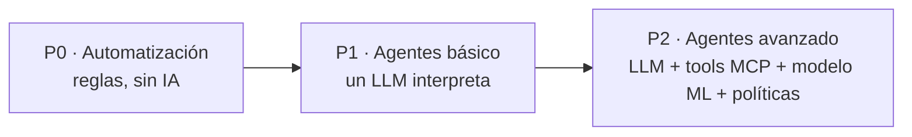

# Agentes inteligentes low-code con n8n

Material del estudiante para un curso de tres prácticas que muestra, paso a paso, la transición de una **automatización** basada en reglas a un **sistema multiagente** con herramientas y un modelo de Machine Learning.



| Práctica | Caso | Conceptos nuevos | Plantillas |
|---|---|---|---|
| **P0** Automatización | Microservicio `GET /clima?ciudad=` | Trigger, nodo, JSON, expresiones, IF, webhook | [`demo-intro/workflow/`](demo-intro/workflow/) |
| **P1** Agentes básico | Registro de gastos por chat con 3 agentes | AI Agent, *prompt*, memoria, paralelismo, *tokens* | [`demo-basic/workflow/`](demo-basic/workflow/) |
| **P2** Agentes avanzado | Retención de clientes (anti-churn) con 5 agentes | Tools, MCP, ML como herramienta, salida estructurada | [`demo-advanced/workflow/`](demo-advanced/workflow/) |

## Descarga del material

1. En la parte superior de esta página, seleccionar el botón verde **Code**.
2. Seleccionar **Download ZIP** y descomprimir el archivo.
3. Las plantillas `.json` se importan en n8n desde **Workflows → menú ⋯ → Import from File**.

Quien use git puede clonarlo con `git clone` y la URL que aparece en el mismo botón **Code**.

## Guías

1. [Preparación: cuentas y credenciales](docs/alumno/00-preparacion-cuentas.md)
2. [Práctica 0: automatización](docs/alumno/01-practica-0-automatizacion.md)
3. [Práctica 1: agentes básico](docs/alumno/02-practica-1-agentes-basico.md)
4. [Práctica 2: agentes avanzado](docs/alumno/03-practica-2-agentes-avanzado.md)
5. [Modalidades gratuita (Groq) y de pago (DeepSeek) y sus restricciones](docs/alumno/modalidades-y-restricciones.md)

## Modalidades

Las prácticas con IA (P1 y P2) incluyen dos plantillas con los mismos *prompts* y la misma lógica:

| Plantilla | Proveedor | Costo | Restricción principal |
|---|---|---|---|
| `workflow-groq-free.json` | Groq | Gratuito | 8.000 *tokens* por minuto por modelo |
| `workflow-deepseek.json` | DeepSeek | Pago por uso (centavos de dólar por sesión) | Requiere saldo prepagado |

La plantilla de pago se genera a partir de la gratuita con el siguiente comando:

```bash
uv run scripts/make_deepseek.py
```

## Estructura del repositorio

| Ruta | Contenido |
|---|---|
| `docs/alumno/` | Guías paso a paso |
| `demo-intro/` | P0: flujo del servicio de clima |
| `demo-basic/` | P1: *prompts* y plantillas (Groq y DeepSeek) |
| `demo-advanced/` | P2: *prompts*, plantillas y `ml-service` (FastAPI, FastMCP y Random Forest) |
| `scripts/` | `make_deepseek.py`, generador de la plantilla de pago |
| `render.yaml` | Despliegue de una copia propia del `ml-service` en Render |
