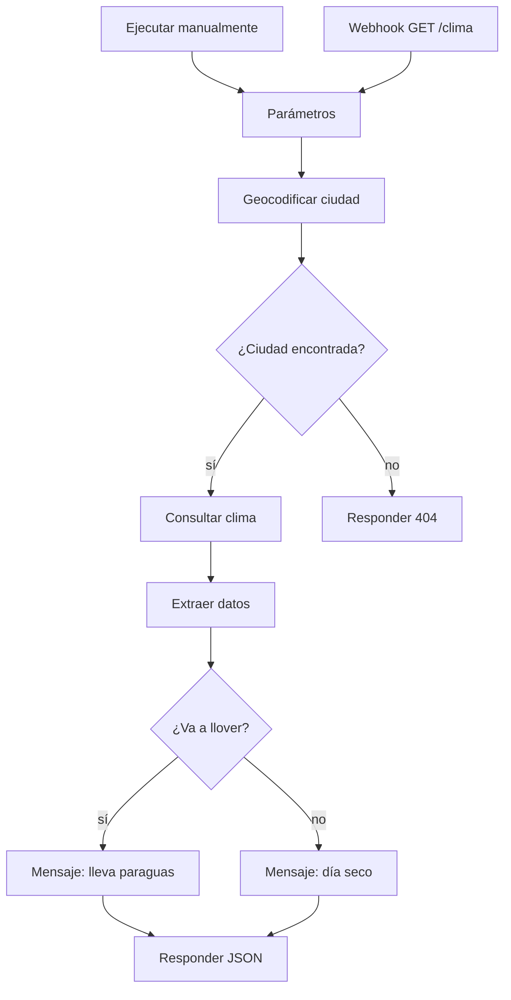

# Práctica 0: automatización con n8n. Construcción de un microservicio sin código

**Duración:** 60 a 90 minutos · **Requisitos:** n8n ([preparación](00-preparacion-cuentas.md)) · **Inteligencia artificial:** no se utiliza

## Objetivos

Al finalizar la práctica, el estudiante estará en capacidad de:

1. Explicar qué es una automatización: **un evento desencadena una secuencia de pasos que transforman datos**.
2. Identificar los elementos de un flujo de n8n: *trigger*, nodo, *item*, JSON y expresión.
3. Consumir una API REST pública y extraer únicamente los campos necesarios.
4. Tomar decisiones con reglas fijas mediante el nodo **IF**.
5. Publicar el flujo como un **servicio HTTP** que cualquier cliente puede invocar.

## Resultado esperado

Un servicio `GET /clima?ciudad=Medellin` que responde con un JSON como el siguiente:

```json
{
  "ciudad": "Medellín",
  "pais": "Colombia",
  "temperatura_actual_c": 25,
  "prob_lluvia_pct": 51,
  "mensaje": "En Medellín hay 51% de probabilidad de lluvia hoy. Lleva paraguas. Ahora: 25 °C."
}
```



El flujo utiliza la API gratuita **Open-Meteo**, que no requiere registro ni clave de acceso.

---

## Conceptos clave

| Concepto | Definición | Aplicación en este flujo |
|---|---|---|
| **Trigger** | Evento que inicia el flujo | Un clic (ejecución manual) o una petición HTTP (webhook) |
| **Nodo** | Paso que recibe datos, los procesa y entrega un resultado | Obtener coordenadas, consultar el clima, decidir |
| **Item** | Unidad de datos que circula entre nodos; siempre es un objeto JSON | `{ "ciudad": "Bogota", "umbral_lluvia": 50 }` |
| **Expresión** | Fragmento de código entre `{{ }}` que lee datos de nodos anteriores | `{{ $json.ciudad }}` |
| **Rama** | Camino alternativo que depende de una condición | Lluvia o no lluvia; ciudad existente o inexistente |
| **Ejecución** | Corrida completa del flujo, registrada en el historial | Pestaña **Executions** |

**Idea central:** una automatización es **determinista**. Con la misma entrada produce siempre la misma salida, porque todas las reglas están escritas de forma explícita. En la Práctica 1, uno de estos nodos será un modelo de lenguaje que interpreta la entrada por sí mismo.

---

## Parte A: construcción del flujo (ejecución manual)

El flujo se construye a mano. Como referencia, la solución está disponible en [`demo-intro/workflow/workflow-intro.json`](../../demo-intro/workflow/workflow-intro.json) (**⋯ → Import from File**).

### Paso 1: crear el flujo y el trigger manual

1. Seleccionar **Workflows → + Add workflow** y nombrar el flujo `P0 - Servicio de clima`.
2. Seleccionar **Add first step** y buscar **Manual Trigger** (*Trigger manually*).

### Paso 2: nodo `Parámetros` (Edit Fields / Set)

1. Seleccionar el **+** a la derecha del trigger y buscar **Edit Fields (Set)**.
2. Renombrar el nodo como `Parámetros` (doble clic sobre el título).
3. En **Mode**, elegir *Manual Mapping* y agregar dos campos con **Add Field**:
   - `ciudad` (String) = `{{ $json.query?.ciudad ?? 'Bogota' }}`
   - `umbral_lluvia` (Number) = `50`
4. Desactivar **Include Other Input Fields**.
5. Seleccionar **Execute step** y revisar la salida en el panel derecho: `ciudad` toma el valor `Bogota`.

**Nota:** la expresión `$json.query?.ciudad ?? 'Bogota'` permite que el mismo nodo sirva para los dos triggers. Cuando el flujo lo inicia el webhook (Parte B), la ciudad llega en `query.ciudad`; con el trigger manual no existe `query` y se usa `Bogota` como valor por defecto.

### Paso 3: nodo `Geocodificar ciudad` (HTTP Request)

Open-Meteo trabaja con latitud y longitud, no con nombres. Por eso, primero se convierte el nombre de la ciudad en coordenadas.

1. Agregar un nodo **HTTP Request** y renombrarlo como `Geocodificar ciudad`.
2. **Method:** `GET`.
3. **URL** (con el campo en modo **Expression**):
   ```
   https://geocoding-api.open-meteo.com/v1/search?name={{ encodeURIComponent($json.ciudad) }}&count=1&language=es&format=json
   ```
4. Seleccionar **Execute step** y revisar la salida en la vista **JSON**: el arreglo `results` contiene `latitude`, `longitude`, `name` y `country`.

### Paso 4: nodo `¿Ciudad encontrada?` (IF)

Cuando la ciudad no existe, la respuesta no incluye `results`. Este caso debe manejarse de forma explícita.

1. Agregar un nodo **If** y renombrarlo como `¿Ciudad encontrada?`.
2. Configurar la condición: **value 1** = `{{ ($json.results || []).length }}`, operador **Number → is greater than**, **value 2** = `0`.
3. El nodo queda con dos salidas: **true** y **false**.

### Paso 5: nodo `Consultar clima` (HTTP Request, rama *true*)

1. Desde la salida **true**, agregar un nodo **HTTP Request** y renombrarlo como `Consultar clima`.
2. **URL** (modo Expression):
   ```
   https://api.open-meteo.com/v1/forecast?latitude={{ $json.results[0].latitude }}&longitude={{ $json.results[0].longitude }}&current=temperature_2m,wind_speed_10m&daily=precipitation_probability_max,temperature_2m_max,temperature_2m_min&forecast_days=1&timezone=auto
   ```
3. Seleccionar **Execute step**. La respuesta contiene mucha más información de la necesaria.

### Paso 6: nodo `Extraer datos` (Edit Fields)

Este paso conserva solo la información útil y le asigna nombres claros. A esta operación se le llama **transformación** o **mapeo** de datos.

1. Agregar un nodo **Edit Fields (Set)**, renombrarlo como `Extraer datos` y desactivar **Include Other Input Fields**.
2. Agregar los siguientes campos:

| Campo | Tipo | Valor |
|---|---|---|
| `ciudad` | String | `{{ $('Geocodificar ciudad').first().json.results[0].name }}` |
| `pais` | String | `{{ $('Geocodificar ciudad').first().json.results[0].country }}` |
| `temperatura_actual_c` | Number | `{{ $json.current.temperature_2m }}` |
| `temperatura_max_c` | Number | `{{ $json.daily.temperature_2m_max[0] }}` |
| `temperatura_min_c` | Number | `{{ $json.daily.temperature_2m_min[0] }}` |
| `prob_lluvia_pct` | Number | `{{ $json.daily.precipitation_probability_max[0] }}` |
| `viento_kmh` | Number | `{{ $json.current.wind_speed_10m }}` |

**Nota:** existen dos formas de leer datos. `$json` es el *item* que **acaba de llegar** al nodo (en este caso, la respuesta del clima). `$('Nombre del nodo').first().json` lee la salida de **cualquier nodo anterior** por su nombre. Si un nodo se renombra, deben actualizarse las expresiones que lo referencian.

### Paso 7: nodo `¿Va a llover?` (IF)

1. Agregar un nodo **If** y renombrarlo como `¿Va a llover?`.
2. Condición: `{{ $json.prob_lluvia_pct }}`, operador **Number → is greater than or equal to**, valor `{{ $('Parámetros').first().json.umbral_lluvia }}`.

### Paso 8: mensajes (Edit Fields)

1. Desde la salida **true**, agregar un nodo **Edit Fields (Set)** llamado `Mensaje: lleva paraguas`, **con** *Include Other Input Fields* activado, y un campo:
   - `mensaje` (String) = `En {{ $json.ciudad }} hay {{ $json.prob_lluvia_pct }}% de probabilidad de lluvia hoy. Lleva paraguas. Ahora: {{ $json.temperatura_actual_c }} °C.`
2. Desde la salida **false**, agregar otro nodo **Edit Fields** llamado `Mensaje: día seco`, con el campo:
   - `mensaje` (String) = `En {{ $json.ciudad }} la probabilidad de lluvia es baja ({{ $json.prob_lluvia_pct }}%). Ahora: {{ $json.temperatura_actual_c }} °C, máxima {{ $json.temperatura_max_c }} °C.`

### Paso 9: ejecución completa

Seleccionar **Execute workflow** (parte inferior central) y revisar, nodo por nodo, qué datos entraron y cuáles salieron. Después, cambiar `umbral_lluvia` a `10` y ejecutar de nuevo: el flujo debe tomar la otra rama.

**Verificación:** el último nodo ejecutado contiene un campo `mensaje` coherente con el valor de `prob_lluvia_pct`.

---

## Parte B: publicación como servicio HTTP (webhook)

Hasta este punto, el flujo se inicia con un clic. En esta parte se configura para que lo inicie **cualquier programa** mediante una petición HTTP; es decir, se convierte en un microservicio.

### Paso 10: agregar el trigger Webhook

1. Seleccionar el **+** del lienzo (esquina superior derecha) y buscar **Webhook**.
2. Renombrar el nodo como `Webhook GET /clima`.
3. Configurar **HTTP Method:** `GET`, **Path:** `clima` y **Respond:** *Using 'Respond to Webhook' Node*.
4. Conectar su salida a la entrada de `Parámetros`. El flujo queda con **dos triggers** que alimentan el mismo camino.

### Paso 11: nodos de respuesta

1. Después de `Mensaje: lleva paraguas`, agregar un nodo **Respond to Webhook** llamado `Responder JSON`, con **Respond With:** *First Incoming Item*. Conectar también `Mensaje: día seco` a este nodo.
2. Desde la salida **false** de `¿Ciudad encontrada?`, agregar un nodo **Respond to Webhook** llamado `Responder 404`:
   - **Respond With:** *JSON*
   - **Response Body:** `{{ { "error": "Ciudad no encontrada", "ciudad": $('Parámetros').first().json.ciudad } }}`
   - **Options → Add option → Response Code:** `404`

**Nota:** en una ejecución manual, los nodos *Respond to Webhook* no envían respuesta a ningún cliente; únicamente transmiten los datos. Solo responden cuando el flujo fue iniciado por el webhook.

### Paso 12: prueba con la URL de prueba

1. En el nodo `Webhook GET /clima`, abrir la pestaña **Test URL** y copiarla. Tiene la forma `https://.../webhook-test/clima`.
2. Seleccionar **Listen for test event**.
3. Desde el navegador o una terminal, ejecutar:
   ```bash
   curl "https://.../webhook-test/clima?ciudad=Medellin"
   ```
4. Probar también una ciudad inexistente (`?ciudad=Xyzzy`); la respuesta debe tener código **404**.

### Paso 13: publicación (URL de producción)

1. Guardar el flujo (**Ctrl/Cmd + S**) y seleccionar **Publish**. En versiones anteriores de n8n, el equivalente es el interruptor **Active**.
2. Utilizar la **Production URL** (`.../webhook/clima`, sin `-test`). El servicio responde de forma permanente, sin necesidad de mantener abierto el editor.
3. Revisar la pestaña **Executions**: cada llamada queda registrada con sus datos.

**Verificación:**

```bash
curl "http://localhost:5678/webhook/clima?ciudad=Lima"     # n8n local
curl "https://<espacio>.app.n8n.cloud/webhook/clima"       # n8n Cloud (usa Bogota por defecto)
```

---

## Problemas frecuentes

| Síntoma | Causa | Solución |
|---|---|---|
| La expresión aparece en rojo | El nodo referenciado no se ha ejecutado o cambió de nombre | Ejecutar los pasos anteriores y revisar el nombre exacto dentro de `$('...')` |
| `Cannot read properties of undefined (reading 'latitude')` | La ciudad no existe y falta el IF del paso 4 | Agregar el nodo `¿Ciudad encontrada?` |
| `404 webhook not registered` con la Test URL | No se seleccionó **Listen for test event**, o transcurrieron sus 120 segundos | Seleccionarlo de nuevo y repetir la petición |
| La Production URL no responde | El flujo no está publicado ni activo | Seleccionar **Publish** o activar **Active** |
| El webhook responde vacío | Falta el nodo *Respond to Webhook* en una de las ramas | Verificar que ambas ramas terminen en un nodo de respuesta |

## Retos de extensión

1. **Parámetro adicional:** aceptar `?umbral=30` en la URL para modificar el umbral de lluvia sin editar el flujo.
2. **Trigger temporal:** agregar un **Schedule Trigger** que se ejecute todos los días a las 6:00 y envíe el mensaje a un canal de Discord mediante un *Discord Webhook* (sin OAuth).
3. **Varias ciudades:** aceptar `?ciudades=Bogota,Lima,Quito` y responder con una lista (sugerencia: nodo **Split Out**).
4. **Validación de entrada:** si `ciudad` llega vacía o supera los 60 caracteres, responder con código **400** antes de llamar a la API.

## Preguntas de reflexión

1. Para responder a la pregunta *"¿conviene salir en bicicleta hoy?"*, ¿cuántas reglas IF serían necesarias para cubrir todos los casos?
2. ¿En qué se parece este flujo a un *endpoint* programado con FastAPI o Express? ¿Qué ventajas y desventajas tiene?
3. Si Open-Meteo cambiara el nombre de un campo, ¿qué nodo fallaría y cómo se detectaría el problema?

**Nota:** la respuesta a la pregunta 1 se retoma en la [Práctica 1](02-practica-1-agentes-basico.md), donde un modelo de lenguaje interpreta el mensaje en lugar de un conjunto de reglas escritas a mano.
