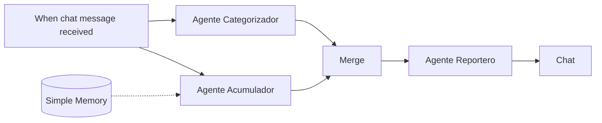

# Práctica 1: agentes básico. Registro de gastos con tres agentes

**Duración:** 60 a 90 minutos · **Requisitos:** [Práctica 0](01-practica-0-automatizacion.md) y credencial de Groq o DeepSeek · **Inteligencia artificial:** sí

## Objetivos

Al finalizar la práctica, el estudiante estará en capacidad de:

1. Explicar qué cambia cuando un nodo del flujo es un **modelo de lenguaje** en lugar de una regla fija.
2. Configurar un **AI Agent** en n8n: modelo, *prompt* y memoria opcional.
3. Ejecutar dos agentes **en paralelo** y unir sus resultados con un nodo **Merge**.
4. Utilizar la **memoria** de un agente para mantener el estado entre mensajes.
5. Reconocer los límites de un proveedor gratuito (*tokens* por minuto) y diseñar el flujo teniéndolos en cuenta.

## Relación con la Práctica 0

En la P0, cada regla se escribió de forma explícita: *si la probabilidad es mayor o igual a 50, el mensaje recomienda llevar paraguas*. En esta práctica, el usuario escribe en lenguaje libre ("Gaste 45 lucas en Rappi", "Uber al trabajo, 12.500"). Escribir una regla IF para cada forma posible de expresar un gasto no es viable. Por esa razón, un **modelo de lenguaje** interpreta el texto siguiendo unas **instrucciones** (el *prompt*).

| | P0 (automatización) | P1 (agentes) |
|---|---|---|
| Quién decide | Reglas IF escritas por el estudiante | El modelo, guiado por el *prompt* |
| Entrada | Parámetros estructurados (`?ciudad=`) | Texto libre |
| Resultado | Siempre idéntico para la misma entrada | Puede variar ligeramente entre ejecuciones |
| Dificultad principal | Cubrir todos los casos | Redactar buenas instrucciones y controlar el formato de salida |

## Resultado esperado

Un chat en el que el usuario registra sus gastos del día y el sistema los clasifica, los acumula y emite una recomendación.



- **Agente Categorizador:** clasifica el gasto del mensaje actual en una de siete categorías y extrae el monto.
- **Agente Acumulador:** se ejecuta **en paralelo**. Dispone de **memoria**, por lo que conserva los gastos anteriores y calcula el total y los subtotales por categoría.
- **Merge:** espera a ambos agentes y combina sus resultados.
- **Agente Reportero:** lee los dos reportes y redacta el mensaje final con una recomendación.

**Nota:** tanto el Categorizador como el Acumulador clasifican el gasto. La duplicación es intencional: al no depender uno del otro, pueden ejecutarse al mismo tiempo.

## Conceptos clave

| Concepto | Definición |
|---|---|
| **AI Agent** | Nodo que envía un *prompt* a un modelo de lenguaje y devuelve su respuesta en el campo `output` |
| **Chat Model** | Sub-nodo que define el proveedor y el modelo (Groq, DeepSeek, etc.) |
| **System Message** | Instrucciones permanentes del agente: su rol y la forma de responder |
| **User Message** | Contenido que se envía en cada turno (en este caso, el mensaje del usuario) |
| **Memory** | Sub-nodo que almacena los últimos N turnos y los reenvía al modelo |
| **Token** | Unidad con la que los proveedores miden el texto (aproximadamente tres cuartos de palabra). Los límites y los precios se expresan en *tokens* |

---

## Modalidades: selección de la plantilla

| Plantilla | Archivo | Credencial |
|---|---|---|
| **Gratuita (Groq)** | [`demo-basic/workflow/workflow-groq-free.json`](../../demo-basic/workflow/workflow-groq-free.json) | `Groq account` |
| **De pago (DeepSeek)** | [`demo-basic/workflow/workflow-deepseek.json`](../../demo-basic/workflow/workflow-deepseek.json) | `DeepSeek account` |

Los *prompts* y la lógica son **idénticos**; solo cambia el nodo de modelo. Las diferencias y los límites se detallan en [modalidades-y-restricciones.md](modalidades-y-restricciones.md).

**Modelos de la plantilla gratuita:**

| Agente | Modelo (Groq) | Justificación |
|---|---|---|
| Categorizador | `openai/gpt-oss-120b` | Tarea breve |
| Acumulador | `openai/gpt-oss-120b` | Debe razonar sobre el contenido de la memoria |
| Reportero | `openai/gpt-oss-20b` | Recibe el texto más extenso. Al usar **otro modelo**, dispone de su propia cuota de *tokens* por minuto y no compite con los otros dos agentes |

En la plantilla de pago, los tres agentes utilizan `deepseek-flash`.

---

## Construcción nodo por nodo

**Nota:** la plantilla puede importarse (**⋯ → Import from File**) y revisarse nodo por nodo con esta guía, o bien construirse desde cero. Los *prompts* se encuentran en [`demo-basic/prompts/`](../../demo-basic/prompts/) y constituyen la fuente de verdad.

### Nodo 1: When chat message received (Chat Trigger)

- Agregar un nodo **Chat Trigger** (*On chat message*).
- **Make Chat Publicly Available:** activado. **Mode:** *Hosted Chat*. Si esta opción está desactivada, la Chat URL publicada responde con error 404.
- **Options → Response Mode:** *Using Response Nodes*.
- Copiar la **Chat URL** pública.

### Nodo 2: Agente Categorizador (AI Agent)

- Agregar un nodo **AI Agent** y renombrarlo como `Agente Categorizador`.
- **Source for Prompt:** *Define below*.
- **Prompt (User Message):** pegar el contenido completo de [`01-categorizador.txt`](../../demo-basic/prompts/01-categorizador.txt), que termina en `{{ $json.chatInput }}`.
- **Require Specific Output Format:** desactivado.
- Sub-nodos: **Chat Model** → Groq → `openai/gpt-oss-120b`. Sin memoria.

### Nodo 3: Agente Acumulador (AI Agent)

- Conectarlo **también** a la salida del Chat Trigger; la misma salida alimenta a ambos agentes.
- **Prompt (User Message):** únicamente `{{ $json.chatInput }}`.
- **Options → System Message:** pegar [`02-acumulador.txt`](../../demo-basic/prompts/02-acumulador.txt) **sin** las dos últimas líneas (`Input del usuario:` y `{{ $json.chatInput }}`).
- Sub-nodos: **Chat Model** → Groq → `openai/gpt-oss-120b`. **Memory** → **Simple Memory**, *Context Window Length* = `10`.

**Importante:** en un agente con memoria, las instrucciones deben ubicarse en el **System Message**. La memoria almacena el *User Message* de cada turno; si las instrucciones estuvieran allí, se repetirían en cada llamada, el tamaño de la petición crecería turno a turno y Groq la rechazaría por exceder el límite de *tokens* por minuto.

### Nodo 4: Merge

- Agregar un nodo **Merge** con **Number of Inputs:** `2` (el resto de opciones, por defecto).
- Entrada 1: `Agente Categorizador`. Entrada 2: `Agente Acumulador`.

### Nodo 5: Agente Reportero (AI Agent)

- **Prompt (User Message):** pegar [`03-reportero.txt`](../../demo-basic/prompts/03-reportero.txt), que termina con:
  ```
  REPORTE DEL CATEGORIZADOR:
  {{ $('Agente Categorizador').first().json.output }}

  REPORTE DEL ACUMULADOR:
  {{ $('Agente Acumulador').first().json.output }}
  ```
- Sub-nodos: **Chat Model** → Groq → `openai/gpt-oss-20b`. Sin memoria.

- **Settings → Execute Once:** activado. El Merge entrega dos *items*; sin esta opción, el Reportero se ejecutaría dos veces y enviaría dos respuestas.

**Nota:** se utiliza `.first()` y no `.item`. Después de un Merge, `.item` pierde la referencia al *item* de origen y la expresión queda marcada en rojo. Es la misma construcción `$('Nodo').first()` empleada en la P0.

### Nodo 6: Chat (respuesta al usuario)

- Agregar un nodo **Respond to Chat** (`Chat`) con **Message:** `{{ $json.output }}`.

---

## Prueba

1. Asignar la credencial en los tres nodos de modelo (si se llama `Groq account`, la asignación es automática).
2. Guardar y **publicar** el flujo. Abrir la **Chat URL**.
3. Enviar los siguientes mensajes, **uno por turno**:
   1. `Gaste 45 lucas en Rappi`
   2. `Uber al trabajo, 12.500`
   3. `Pague la luz, 180k`
   4. `Cine con mi novia, 30k`
   5. `Compre un libro de Python por 75000`

**Verificación:**

- El total aumenta en cada turno: 45.000, 57.500, 237.500, 267.500 y 342.500.
- Cada gasto se asigna a la categoría correcta.
- La recomendación cambia según la categoría dominante.
- En **Executions** se observa que el Categorizador y el Acumulador se ejecutaron en paralelo.

Ejemplo de respuesta en el turno 4: *"Listo, registré 30.000 COP en Entretenimiento (cine). Hoy llevas 267.500 COP en 4 gastos, con Servicios liderando (67 %)…"*

## Categorías

| Categoría | Ejemplos |
|---|---|
| Comida | Rappi, restaurante, mercado, café |
| Transporte | Uber, DiDi, bus, gasolina, parqueadero |
| Entretenimiento | Cine, Netflix, concierto, salida con amigos |
| Servicios | Luz, agua, internet, gas, celular |
| Salud | Farmacia, EPS, gimnasio, terapia |
| Educacion | Curso, libro, plataforma, suscripción académica |
| Otros | Cualquier gasto que no corresponda a las categorías anteriores |

## Referencia de expresiones

```
{{ $json.chatInput }}                                 # mensaje del usuario
{{ $('Agente Categorizador').first().json.output }}  # salida del Categorizador (texto)
{{ $('Agente Acumulador').first().json.output }}     # salida del Acumulador (texto)
{{ $json.output }}                                    # salida del agente anterior
```

Como no se utiliza *Structured Output Parser*, `output` es **texto plano**. Los *prompts* exigen un formato fijo (`Categoria:`, `Monto:`, `Por categoria:`) para que el Reportero pueda interpretarlo.

## Problemas frecuentes

| Síntoma | Causa | Solución |
|---|---|---|
| La expresión del Reportero aparece en rojo | Se utilizó `.item` después del Merge | Reemplazar por `.first()` |
| El Reportero solo considera uno de los dos reportes | Se utilizó `$json.output` directamente | Usar `$('Agente …').first().json.output` para cada agente |
| Error `429`, *rate limit* o *tokens per minute* | Se superó el límite gratuito de Groq | Esperar un minuto. Verificar que las instrucciones del Acumulador estén en el **System Message**. Ver [restricciones](modalidades-y-restricciones.md) |
| El Acumulador omite gastos antiguos | *Context Window Length* demasiado bajo | Aumentarlo (de 10 a 20). Más memoria implica más *tokens* por llamada |
| El total se reinicia | Se reinició n8n o se abrió otra sesión de chat | Comportamiento esperado: la memoria reside en RAM y es independiente por sesión |
| La suma es incorrecta | Los modelos de lenguaje no son calculadoras | Ver el reto 2 |

## Retos de extensión

1. **Nueva categoría:** agregar `Mascotas`. ¿Cuántos archivos de *prompt* fue necesario modificar y por qué?
2. **Suma exacta:** el modelo puede cometer errores aritméticos. Trasladar la suma a un nodo **Code** (JavaScript) y dejar al modelo únicamente la clasificación. Este reto conecta con la P0: reglas donde las reglas son suficientes, modelos donde se requiere interpretación.
3. **Medición de *tokens*:** en **Executions**, abrir un nodo de modelo y localizar el consumo de *tokens*. Comparar el turno 1 con el turno 5 del Acumulador y explicar el crecimiento.
4. **Cambio de modalidad:** importar la plantilla DeepSeek, enviar los mismos cinco mensajes y comparar calidad, tiempo de respuesta y costo (panel de DeepSeek).

## Preguntas de reflexión

1. Retomando la respuesta de la P0: ¿cuántas reglas IF serían necesarias para interpretar "45 lucas", "45k" y "cuarenta y cinco mil"?
2. Si se envía el mismo mensaje dos veces, ¿la respuesta es idéntica? ¿Es un problema en este caso? ¿Lo sería en un sistema contable?
3. ¿Qué ventaja ofrece ejecutar en paralelo el Categorizador y el Acumulador? ¿Qué costo tiene?
4. ¿Qué información personal se envía a un proveedor externo? ¿Sería aceptable hacerlo con datos reales de un banco?
