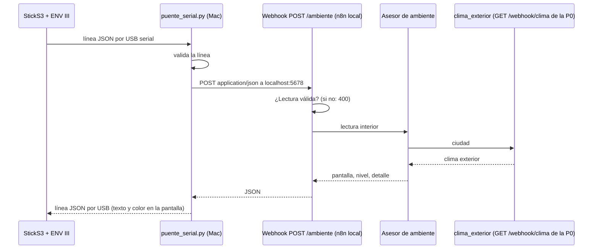
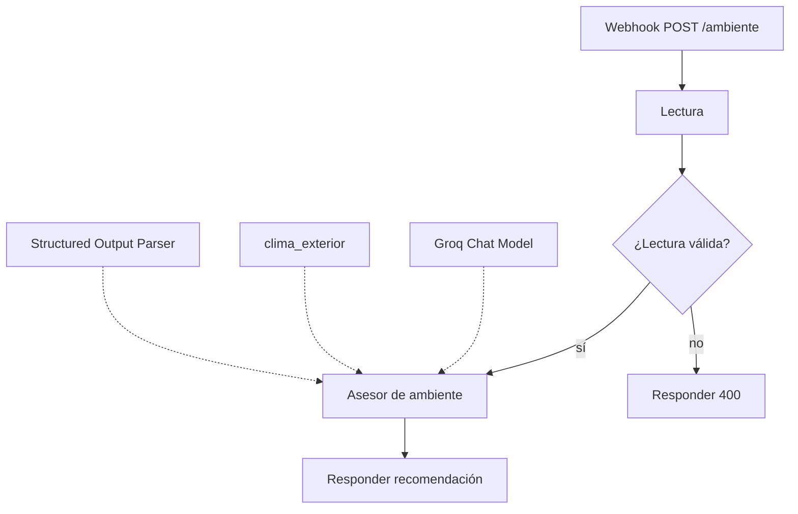
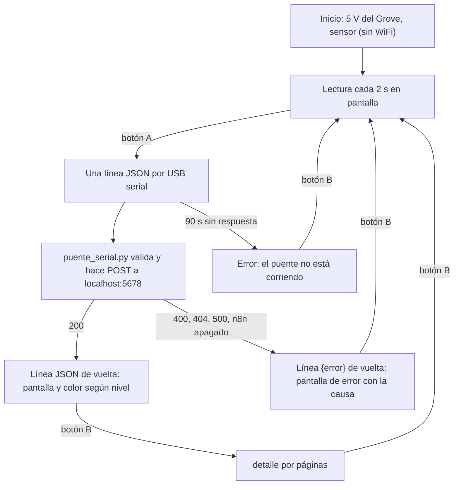

# Práctica 3: agente con un dispositivo físico. Asesor de ambiente con StickS3 y sensor ENV III

**Duración:** 90 minutos · **Requisitos:** [Práctica 0](01-practica-0-automatizacion.md) publicada, credencial `Groq account` o `DeepSeek account` · **Hardware (opcional):** M5Stack StickS3, unidad ENV III y cable USB-C de datos (sin WiFi)

## Objetivos

Al finalizar la práctica, el estudiante estará en capacidad de:

1. Conectar un agente con un **evento del mundo físico**: una medición de un sensor enviada por un dispositivo.
2. Reutilizar un servicio propio (el `/clima` de la Práctica 0) como **herramienta** de un agente.
3. Diseñar una **salida estructurada para un dispositivo**, cuyo contrato es más estricto que el de una persona: texto corto, sin tildes y con un nivel que se traduce en un color.
4. Validar los datos de entrada **antes** de invocar al modelo, con reglas fijas.

## Relación con las prácticas anteriores

| Práctica | Quién inicia el flujo | Quién decide | Quién lee la respuesta |
|---|---|---|---|
| P0 | Una petición HTTP | Reglas IF | Un programa (JSON) |
| P1 | Una persona en el chat | Un LLM | Una persona |
| P2 | Una persona en el chat | LLM, herramientas MCP, modelo ML y políticas | Una persona |
| **P3** | **Un dispositivo con un sensor** | **Un LLM con una herramienta construida en la P0** | **El mismo dispositivo (pantalla de 1,14")** |

La P3 cierra el recorrido: el microservicio de la P0 deja de ser un producto final y se convierte en una herramienta que un agente decide cuándo usar.

## Caso de estudio

Un StickS3 con un sensor ENV III mide la temperatura, la humedad y la presión de un salón. Al pulsar el botón A, el dispositivo escribe la lectura como una línea JSON en el cable USB-C; un pequeño programa en Python que corre en el Mac (el **puente serial**) la reenvía al webhook local de n8n. El agente **Asesor de ambiente** consulta el clima exterior de la ciudad, compara ambos ambientes y devuelve una recomendación breve, por ejemplo *"Abre ventanas: afuera 21C, adentro 27C"*, que se muestra en la pantalla con un fondo verde, amarillo o rojo según el nivel.



**Sin WiFi:** el StickS3 no usa la red. El firmware no incluye la biblioteca WiFi, así que el radio nunca se enciende, y todo el tráfico entre el dispositivo, el Mac y n8n queda dentro del computador. Esto permite usarlo en redes corporativas o universitarias que no admiten dispositivos propios. El flujo de n8n sí necesita salida a internet para llamar al modelo (Groq o DeepSeek) y a Open-Meteo, igual que en las prácticas anteriores.

**Nota:** el dispositivo es opcional. El script `scripts/simular_gadget.py` envía las mismas peticiones que el puente, de modo que toda la práctica puede realizarse sin hardware.

---

## Conceptos clave

| Concepto | Definición | Aplicación en este flujo |
|---|---|---|
| **Evento físico** | Medición del entorno que inicia un flujo | La lectura del ENV III enviada al pulsar el botón A |
| **Puente serial** | Programa que traduce entre un puerto serie y HTTP | `puente_serial.py` lee líneas JSON del USB y las envía por POST al webhook |
| **Herramienta compuesta** | Servicio propio que un agente utiliza como herramienta | El flujo `/clima` de la P0, expuesto con un *HTTP Request Tool* |
| **`$fromAI()`** | Expresión que deja que el modelo complete un parámetro de la herramienta | El agente decide qué ciudad consultar |
| **Contrato con un dispositivo** | Formato de salida que respeta los límites del cliente | `pantalla` de máximo 60 caracteres, sin tildes; `nivel` con tres valores |
| **Validación previa** | Reglas fijas que filtran datos imposibles antes de usar el modelo | IF con rangos físicos: una humedad de 150 % no llega al LLM |

---

## Modalidades: selección de la plantilla

| Plantilla | Modelo | Tiempo de respuesta observado |
|---|---|---|
| [`workflow-groq-free.json`](../../demo-gadget/workflow/workflow-groq-free.json) | `openai/gpt-oss-20b` en Groq | 3 a 4 segundos |
| [`workflow-deepseek.json`](../../demo-gadget/workflow/workflow-deepseek.json) | `deepseek-flash` | 5 a 6 segundos |

El flujo hace **una** llamada a la herramienta y dos o tres al modelo por lectura, de modo que el límite gratuito de Groq no suele alcanzarse. Los detalles de ambas modalidades se encuentran en [modalidades-y-restricciones.md](modalidades-y-restricciones.md).

---

## Parte A: flujo en n8n y prueba con el simulador

### Paso 1: preparar el servicio de la Práctica 0

1. Abrir el flujo de la P0 y confirmar que está **publicado**.
2. Verificar en una terminal que responde:
   ```bash
   curl "http://localhost:5678/webhook/clima?ciudad=Bogota"
   ```

**Importante:** si la P0 no está publicada, la herramienta `clima_exterior` recibe un 404 y el agente decide solo con la lectura interior.

### Paso 2: importar la plantilla

1. **Workflows → menú ⋯ → Import from File** y elegir la plantilla de la modalidad.
2. Abrir el nodo del modelo (`Groq Chat Model` o `DeepSeek Chat Model`) y confirmar que tiene asignada la credencial.
3. **Solo en n8n Cloud:** abrir el nodo `clima_exterior` y reemplazar `http://localhost:5678` por la URL del espacio (`https://<espacio>.app.n8n.cloud`).

### Paso 3: recorrido del flujo nodo por nodo



| Nodo | Tipo | Función |
|---|---|---|
| `Webhook POST /ambiente` | Webhook | Recibe el JSON del dispositivo en `body`. **Respond:** *Using 'Respond to Webhook' Node* |
| `Lectura` | Edit Fields | Extrae los cinco campos de `body`. `ciudad` toma `Bogota` y `dispositivo` toma `simulador` si no llegan (mismo patrón `??` que el nodo `Parámetros` de la P0); también acepta `device` como sinónimo de `dispositivo`. `humedad_pct` y `presion_hpa` quedan en `null` si no llegan, para admitir sensores que solo miden temperatura |
| `¿Lectura válida?` | If | Cinco condiciones: la temperatura existe y está entre -20 y 60 °C; la humedad es `null` o está entre 0 y 100 %; la presión es `null` o está entre 500 y 1100 hPa |
| `Asesor de ambiente` | AI Agent | *Prompt* en el **System Message**; el **User Message** contiene la lectura en JSON |
| `clima_exterior` | HTTP Request Tool | `GET http://localhost:5678/webhook/clima`, con el parámetro `ciudad` = `{{ $fromAI('ciudad', ...) }}` |
| `Structured Output Parser` | Output Parser | Esquema con `pantalla` (máximo 60 caracteres), `nivel` (`ok`, `atencion`, `alerta`) y `detalle` |
| `Responder recomendación` | Respond to Webhook | Devuelve `{{ $json.output }}` con código 200 |
| `Responder 400` | Respond to Webhook | Devuelve el error y el cuerpo recibido, con código 400 |

**Nota sobre la presión:** el rango empieza en 500 hPa porque la presión disminuye con la altitud. En Bogotá (2.600 m) un barómetro marca unos 750 hPa; un rango de 800 a 1100 hPa rechazaría las lecturas reales.

El *prompt* completo se encuentra en [`demo-gadget/prompts/01-asesor-ambiente.txt`](../../demo-gadget/prompts/01-asesor-ambiente.txt). Define los rangos de confort (20 a 26 °C y 40 a 60 % de humedad), las reglas del campo `pantalla` y la sección **ENTREGA DE LA RESPUESTA FINAL**, necesaria para que el Structured Output Parser reciba la clave `output`.

### Paso 4: probar el webhook con `curl` (URL de prueba y URL de producción)

El webhook tiene dos direcciones. Ambas reciben el mismo JSON:

| URL | Cuándo atiende | Dónde se ve la ejecución |
|---|---|---|
| `http://localhost:5678/webhook-test/ambiente` (prueba) | Solo después de pulsar **Execute workflow** en el editor, y para **una sola** petición | En el lienzo, con los datos en cada nodo |
| `http://localhost:5678/webhook/ambiente` (producción) | Siempre, mientras el flujo esté **publicado** | En **Executions** |

**Importante:** en este caso n8n corre en Docker y publica el puerto 5678 en el Mac, por eso `localhost:5678` funciona tanto para `curl` como para el puente. Las dos URL aparecen en el nodo `Webhook POST /ambiente`, pestañas **Test URL** y **Production URL**.

1. **Con la URL de prueba.** En el editor, pulsar **Execute workflow** (el webhook queda escuchando) y, en una terminal, enviar la lectura de referencia:
   ```bash
   curl -i -X POST http://localhost:5678/webhook-test/ambiente \
     -H "Content-Type: application/json" \
     -d '{"device":"sticks3","temperatura_c":26.4}'
   ```
   Debe responder `HTTP/1.1 200` con `pantalla`, `nivel` y `detalle`, y el lienzo debe mostrar el recorrido en verde. Para repetir, pulsar de nuevo **Execute workflow**.
2. **Cambiar a producción.** Guardar el flujo y seleccionar **Publish**. Desde ese momento, la misma prueba se hace contra la URL de producción, sin pulsar nada en el editor:
   ```bash
   curl -i -X POST http://localhost:5678/webhook/ambiente \
     -H "Content-Type: application/json" \
     -d '{"device":"sticks3","temperatura_c":26.4}'
   ```
3. **Lectura inválida:** debe responder `400` sin invocar al modelo.
   ```bash
   curl -i -X POST http://localhost:5678/webhook/ambiente \
     -H "Content-Type: application/json" \
     -d '{"dispositivo":"curl","temperatura_c":22,"humedad_pct":150}'
   ```

**Nota:** el puente y el simulador usan la URL de producción por defecto. Para usar la de prueba, se pasa con `--url` (ver el Paso 8).

### Paso 5: probar con el simulador

Con el flujo publicado, desde la carpeta del repositorio:

```bash
uv run scripts/simular_gadget.py                    # sin uv: python3 scripts/simular_gadget.py
uv run scripts/simular_gadget.py --ciudad Medellin  # otra ciudad
```

El script envía cinco perfiles con 20 segundos de pausa entre ellos.

**Verificación:**

| Perfil | Lectura | Respuesta esperada |
|---|---|---|
| Confortable | 22,5 °C, 50 % | 200, `nivel: ok`, recomendación de mantener |
| Caluroso y húmedo | 30,8 °C, 76 % | 200, `nivel: alerta`, ventilar o abrir ventanas según el clima exterior |
| Frío | 16 °C, 45 % | 200, `nivel: alerta`; abrir ventanas si afuera está más cálido y no llueve, o cerrarlas y abrigarse en caso contrario |
| Solo temperatura | 26,4 °C, sin humedad ni presión | 200, `nivel: atencion` (26,4 °C está fuera de 20 a 26 °C) |
| Inválido | humedad 150 % | 400, `Lectura invalida` |

En **Executions**, abrir una ejecución y seleccionar el nodo `Asesor de ambiente`: en **Logs** debe aparecer la llamada a `clima_exterior` con la ciudad enviada.

**Nota:** la recomendación depende del clima real del momento. Con el mismo interior, el agente puede recomendar abrir ventanas en una ciudad cálida sin lluvia y cerrarlas en una ciudad fría con lluvia. Esta es la diferencia con la P0: no hay una regla IF para cada combinación.

---

## Parte B: el dispositivo real por USB-C, sin WiFi (opcional)

### Materiales

| Elemento | Función |
|---|---|
| M5Stack StickS3 | ESP32-S3 con pantalla de 1,14" (240 × 135), dos botones y USB-C nativo. La WiFi no se usa |
| Unidad ENV III | SHT30 (temperatura y humedad, I2C 0x44) y QMP6988 (presión, I2C 0x70) |
| Cable Grove (HY2.0-4P) | Conecta el ENV III al puerto Grove del StickS3 (SDA G9, SCL G10) |
| Cable USB-C **de datos** | Carga del firmware y comunicación con el Mac (algunos cables solo cargan) |
| VS Code con la extensión **PlatformIO IDE** | Compilación y carga del firmware |
| `uv` | Ejecuta el puente en Python e instala `pyserial` ([instalación](https://docs.astral.sh/uv/getting-started/installation/): `brew install uv`) |

**Confirmar el sensor:** el firmware está escrito para la unidad **M5Stack ENV III** (I2C, direcciones 0x44 y 0x70, biblioteca `M5Unit-ENV`). Si el sensor Grove disponible es otro (por ejemplo, ENV IV con SHT40 y BMP280, o un sensor analógico de temperatura de Seeed), hay que adaptar `iniciarSensor()` y `leerSensor()` en `src/main.cpp`; el resto (USB, puente y flujo) no cambia. Mientras tanto, se puede probar el enlace completo con la lectura de ejemplo (`LECTURA_DE_EJEMPLO 1`, Paso 6).

### Paso 6: compilar y cargar el firmware

1. En VS Code: **File → Open Folder** y elegir `demo-gadget/firmware`. PlatformIO reconoce el proyecto por el archivo `platformio.ini` e instala lo necesario la primera vez (varios minutos).
2. (Opcional) Copiar `include/config.example.h` como `include/config.h` para cambiar `DISPOSITIVO` (por defecto `sticks3`), `CIUDAD` (por defecto `Bogota`), el envío automático o la lectura de ejemplo. Sin `config.h`, el firmware usa los valores por defecto. No hay claves ni direcciones de red que configurar.
3. Conectar el StickS3 por USB-C y el ENV III al puerto Grove.
4. En la barra inferior de VS Code, seleccionar **PlatformIO: Upload** (flecha hacia la derecha).

Equivalente en la terminal:

```bash
cd demo-gadget/firmware
pio run -t upload
cd ../..
```

**Verificación:** la pantalla muestra la temperatura medida en grande (verde entre 20 y 26 °C, amarillo entre 18 y 28 °C, rojo fuera de ese rango) y, debajo, la humedad, la presión, la ciudad y la línea `USB: conectado`, actualizadas cada 2 segundos.

### Paso 7: identificar el puerto serie

```bash
ls /dev/cu.*
```

El StickS3 aparece como `/dev/cu.usbmodem<número>` (por ejemplo, `/dev/cu.usbmodem101`). Para confirmar cuál es, desconectar el cable, repetir el comando y ver qué línea desaparece. El puente también los lista:

```bash
uv run demo-gadget/puente/puente_serial.py --listar
```

**Importante:** se usa `/dev/cu.*` y no `/dev/tty.*`: en macOS, `tty` espera una señal de "portadora" que el USB no envía y el programa se queda bloqueado al abrirlo.

### Paso 8: ejecutar el puente

Desde la raíz del repositorio, con el flujo P3 publicado:

```bash
uv run demo-gadget/puente/puente_serial.py --puerto /dev/cu.usbmodem101
```

La primera vez, `uv` descarga `pyserial` en un entorno aislado (la dependencia está declarada al inicio del script); no hace falta `pip install` ni activar un entorno virtual. Sin `uv`: `python3 -m pip install pyserial` y `python3 demo-gadget/puente/puente_serial.py --puerto ...`.

Opciones:

| Opción | Uso |
|---|---|
| `--puerto /dev/cu.usbmodemXXX` | Puerto del StickS3. Si se omite y hay un solo `usbmodem`, se detecta solo |
| `--url URL` | Webhook de n8n. Por defecto, la URL de producción `http://localhost:5678/webhook/ambiente`. Para la URL de prueba: `--url http://localhost:5678/webhook-test/ambiente` (pulsar **Execute workflow** antes de cada lectura) |
| `--sin-envio` | Solo lee y valida; no llama a n8n. Sirve para probar el cable y el firmware aislados |
| `--timeout 60` | Segundos de espera por la respuesta de n8n |

**Importante:** cerrar el **Serial Monitor** de PlatformIO antes de ejecutar el puente: un puerto serie solo puede leerlo un programa a la vez. Al abrir el puerto, el StickS3 puede reiniciarse; es normal.

El registro indica en qué tramo está cada mensaje:

```text
17:08:02 INFO    [SERIAL] conectado a /dev/cu.usbmodem101. Esperando lecturas (botón A del StickS3). Ctrl+C para salir.
17:08:02 INFO    [DISPOSITIVO] StickS3 listo. WiFi apagada. Dispositivo=sticks3 ciudad=Bogota
17:08:04 INFO    [LECTURA] {"dispositivo": "sticks3", "ciudad": "Bogota", "temperatura_c": 26.4, "humedad_pct": 55.0, "presion_hpa": 752.1}
17:08:07 INFO    [N8N] HTTP 200 en 3.0 s: nivel=atencion pantalla='Ventilador: adentro 26C, confort 20-26C'
```

| Etiqueta | Tramo |
|---|---|
| `[SERIAL]` | Cable y puerto: no existe, está ocupado o se desconectó (el puente reintenta cada 2 s) |
| `[DISPOSITIVO]` | Mensajes de diagnóstico del firmware (líneas que empiezan con `# `) |
| `[LECTURA]` | La línea llegó; si dice `descartada`, no es JSON o le falta `temperatura_c` numérica |
| `[N8N]` | El POST al webhook: código HTTP y tiempo, o la causa del error |
| `[RESPUESTA]` | No se pudo devolver la respuesta al dispositivo |

### Paso 9: uso y verificación en n8n

| Acción | Resultado |
|---|---|
| Reposo | Lectura local cada 2 segundos; no se envía nada |
| Botón A | El StickS3 escribe la lectura en el USB y muestra "Consultando..."; luego, la recomendación con fondo verde (`ok`), amarillo (`atencion`) o rojo (`alerta`) |
| Botón B sobre la recomendación | Detalle, por páginas; al terminar, vuelve a la lectura |
| Botón B sobre un error | Vuelve a la lectura |

**Verificación en n8n:**

1. Pulsar el botón A y esperar la línea `[N8N] HTTP 200` en el puente.
2. En n8n, abrir **Executions** (con la URL de producción) o mirar el lienzo (con la URL de prueba).
3. Abrir la ejecución y seleccionar el nodo `Lectura`: `temperatura_c` debe tener el mismo valor que la pantalla del StickS3 y `dispositivo` debe ser `sticks3`.

Para provocar un cambio visible, basta con soplar sobre el sensor o acercarlo a una fuente de calor: la humedad y la temperatura suben en pocos segundos.

### Funcionamiento del firmware y del puente



El protocolo por el cable es de texto, una línea por mensaje:

| Sentido | Contenido |
|---|---|
| StickS3 → Mac | `{"dispositivo":"sticks3","ciudad":"Bogota","temperatura_c":26.4,"humedad_pct":55.0,"presion_hpa":752.1}` |
| StickS3 → Mac | `# mensaje de diagnóstico` (el puente lo muestra y no lo envía a n8n) |
| Mac → StickS3 | `{"pantalla":"...","nivel":"...","detalle":"..."}` o `{"error":"..."}` |

Puntos del código que conviene revisar:

- [`src/main.cpp`](../../demo-gadget/firmware/src/main.cpp), `enviarLectura()`: `serializeJson(cuerpo, Serial)` seguido de `Serial.println()` produce exactamente una línea por lectura.
- `atenderUsb()`: lee el USB sin bloquear, para que los botones y la pantalla sigan respondiendo mientras el agente piensa.
- `M5.Power.setExtOutput(true)`: en el StickS3 la salida de 5 V del puerto Grove viene **apagada**; sin esta línea, el sensor no responde.
- `aAscii()`: quita tildes y eñes porque la fuente de la pantalla solo tiene caracteres ASCII.
- [`puente_serial.py`](../../demo-gadget/puente/puente_serial.py), `validar_lectura()`: comprueba la forma (JSON, `temperatura_c` numérica). Los rangos físicos los sigue validando el IF del flujo, que es el que responde 400.

**¿Por qué un puente en el Mac y no n8n leyendo el USB directamente?** n8n corre en Docker, y Docker Desktop en macOS no puede pasar dispositivos USB a los contenedores. El puente corre en macOS, donde sí ve `/dev/cu.usbmodem*`, y se comunica con n8n por el puerto 5678 que Docker publica en `localhost`.

---

## Problemas frecuentes

| Síntoma | Causa | Solución |
|---|---|---|
| `curl` o el puente reciben 404 `webhook "POST ambiente" is not registered` | El flujo P3 no está publicado | Seleccionar **Publish** |
| 404 con la URL `webhook-test` | No se pulsó **Execute workflow**, o ya atendió su única petición | Pulsarlo de nuevo antes de cada lectura, o publicar y usar la URL de producción |
| La recomendación no menciona el clima exterior | La P0 no está publicada y `clima_exterior` recibe 404 | Publicar la P0 y verificar con `curl` |
| `Max iterations` o `400 Bad request` en el agente | Se eliminó la sección **ENTREGA DE LA RESPUESTA FINAL** del *prompt* | Restaurarla |
| `ls /dev/cu.*` no muestra ningún `usbmodem` | Cable que solo carga, o el StickS3 está apagado | Cambiar a un cable USB-C de datos; encender con el botón lateral |
| `[SERIAL] ... está ocupado` | El Serial Monitor de PlatformIO u otro programa tiene el puerto | Cerrarlo y volver a ejecutar el puente |
| `[SERIAL] se perdió la conexión` | Se desconectó el cable o el StickS3 se reinició | El puente reintenta solo; revisar el cable |
| `[LECTURA] descartada: no es JSON válido` en la primera línea | Se abrió el puerto en mitad de una línea | Normal una vez; pulsar de nuevo el botón A |
| `[N8N] n8n no responde ... Connection refused` | El contenedor de n8n está detenido | `docker ps`; si no aparece `n8n`, `docker start n8n` |
| La pantalla muestra "Sin respuesta del Mac" | El puente no está corriendo o se cerró | Ejecutar el puente (Paso 8) |
| La pantalla muestra "USB: sin computador" | Cable de solo carga o conectado a un cargador | Conectar al Mac con un cable de datos |
| La pantalla muestra "Sensor ENV III no detectado" | Cable Grove suelto, falta `setExtOutput(true)` o el sensor no es un ENV III | Revisar el cable; confirmar el modelo del sensor (Parte B) |
| La pantalla muestra "Lectura fuera de rango (400)" | El flujo rechazó la lectura | Revisar en el puente la línea `[N8N] HTTP 400` con el cuerpo recibido |

## Retos de extensión

1. **Lectura periódica:** activar `ENVIO_AUTOMATICO_S 600` en `config.h` y modificar el firmware para mostrar la recomendación solo si el nivel cambia.
2. **Historial:** guardar cada lectura en una **Data Table** de n8n y agregar al agente una herramienta que consulte las últimas 6 lecturas para detectar tendencias.
3. **Notificación:** si el nivel es `alerta`, enviar además un mensaje a un canal de Discord con un *Discord Webhook*.
4. **Varios dispositivos:** usar el campo `dispositivo` para distinguir salones y pedir al agente un resumen comparativo.

## Preguntas de reflexión

1. ¿Por qué la validación de rangos se hace con un nodo IF y no se deja al modelo?
2. El flujo de la P0 ahora es una herramienta. ¿Qué cambiaría si otra persona modificara su formato de respuesta?
3. ¿Qué datos del ambiente de un salón podrían considerarse sensibles si el sistema registrara las lecturas de forma permanente?
4. ¿Qué ocurre con la experiencia del usuario si el modelo tarda 25 segundos? ¿Qué partes del sistema deberían seguir funcionando sin red?
5. El puente valida la forma de la lectura y n8n valida los rangos. ¿Qué ventaja tiene separar ambas validaciones? ¿Qué pasaría si el puente también descartara las lecturas fuera de rango?
