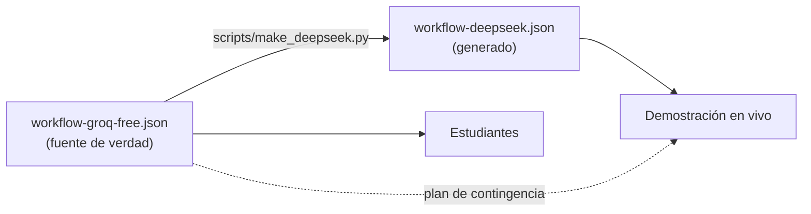

# Modalidades gratuita (Groq) y de pago (DeepSeek)

Las prácticas con inteligencia artificial (P1, P2 y P3) incluyen **dos plantillas** con los mismos *prompts* y la misma lógica. Solo difieren en los nodos de modelo.

| | Gratuita: `workflow-groq-free.json` | De pago: `workflow-deepseek.json` |
|---|---|---|
| Proveedor | Groq | DeepSeek |
| Modelos | `openai/gpt-oss-120b`, `openai/gpt-oss-20b` y `qwen/qwen3.8-27b` (distribuidos entre agentes) | `deepseek-flash` en todos los agentes |
| Costo | USD 0 | Centavos de dólar por sesión de práctica |
| Requiere tarjeta | No | Sí (recarga previa de saldo) |
| Restricción más visible | *Tokens* por minuto | Prácticamente ninguna en el volumen de una práctica |
| Uso recomendado | Estudiantes, en clase y en casa | Demostración en vivo del profesor; estudiantes que deseen comparar |

**Criterio general:** la construcción y el aprendizaje se realizan con la plantilla gratuita. La plantilla de pago se utiliza cuando se requiere confiabilidad (una demostración ante público) o cuando el límite gratuito impide avanzar.



---

## Restricciones de la modalidad gratuita

### 1. Groq: límites por modelo

Groq contabiliza el uso **por modelo y por organización**. Los valores de referencia publicados para `openai/gpt-oss-120b` y `openai/gpt-oss-20b` son:

| Límite | Valor | Implicación práctica |
|---|---|---|
| **TPM** (*tokens* por minuto) | 8.000 | Es el límite más visible. Una petición de la P2, con un *prompt* extenso y su respuesta, puede consumir entre 2.000 y 4.000 *tokens* |
| **RPM** (peticiones por minuto) | 30 | Rara vez se alcanza en estas prácticas |
| **RPD** (peticiones por día) | 1.000 | Suficiente para practicar |
| **TPD** (*tokens* por día) | 200.000 | Equivale a varias decenas de conversaciones de la P2 |

Los límites exactos de cada cuenta se consultan en **console.groq.com → Settings → Limits** y pueden cambiar sin previo aviso.

**Síntoma:** el nodo de modelo falla con `429`, `Rate limit reached` o `tokens per minute (TPM): Limit 8000`.

**Mitigaciones incorporadas en las plantillas:**

| Técnica | Ubicación | Fundamento |
|---|---|---|
| Distribuir los agentes entre modelos distintos | P1 (Reportero en `gpt-oss-20b`) y P2 (tres modelos) | Cada modelo dispone de **su propia** cuota de 8.000 TPM |
| Instrucciones en el **System Message** cuando el agente tiene memoria | Acumulador (P1) y Concierge (P2) | La memoria almacena el *User Message*; si las instrucciones estuvieran allí, se duplicarían en cada turno |
| **Retry On Fail** (3 intentos, 5 segundos) | Todos los agentes de la P2 | Absorbe picos breves sin que falle la conversación completa |
| Memoria limitada a 10 turnos | Agentes con memoria | Más memoria implica más *tokens* por llamada |

**Procedimiento ante el error:** esperar 60 segundos y repetir. En la P2, dejar un minuto entre conversaciones: una conversación completa consume cerca de 20.000 *tokens* en menos de un minuto, repartidos entre los tres modelos.

**Otras restricciones observadas (noviembre de 2026):**

- `llama-3.3-70b-versatile` pasó a precio Enterprise y dejó de estar disponible en la cuenta gratuita.
- `qwen/qwen3.8-27b` es un modelo *preview*: Groq puede retirarlo con poco aviso.
- Los modelos gpt-oss ocasionalmente corrompen el nombre de una herramienta (`format_final_json_response<|channel|>commentary`), lo que produce `400 Bad request`. Por eso el Concierge usa `qwen/qwen3.8-27b`.
- Con algunos modelos, el Concierge vuelve a pedir el motivo aunque ya se haya indicado; basta con responder de nuevo.

**Nota:** si varios estudiantes comparten **la misma** clave de Groq, comparten también los 8.000 TPM. Por esa razón, cada estudiante debe crear su propia clave.

### 2. Render (servicio de ML de la P2): suspensión por inactividad

- En el plan gratuito, el servicio **se suspende tras 15 minutos sin uso**. La primera petición lo reactiva en **aproximadamente un minuto**; durante ese tiempo, el nodo MCP Client puede fallar por *timeout*.
- **Procedimiento:** abrir `https://churn-mcp-demo.onrender.com/health` y esperar la respuesta `"status":"ok"` antes de iniciar el chat.

### 3. n8n Cloud: prueba de 14 días

- Al vencer, se exportan los flujos (**⋯ → Download**) y se continúa con n8n local en Docker ([preparación](00-preparacion-cuentas.md#opción-b-n8n-local-con-docker)). Las plantillas funcionan de la misma manera.

---

## Modalidad de pago: DeepSeek

### Precio de referencia (`deepseek-flash`)

Precios en dólares estadounidenses por **millón** de *tokens*, según la página oficial de precios de DeepSeek (consulta de noviembre de 2026):

| Concepto | Horario valle | Horario pico |
|---|---|---|
| Entrada (en caché) | 0,003 | 0,006 |
| Entrada (sin caché) | 0,15 | 0,30 |
| Salida | 0,60 | 1,20 |

El horario pico comprende de 01:00 a 04:00 y de 06:00 a 10:00 UTC, de lunes a viernes. **En Colombia (UTC−5) corresponde a las franjas de 20:00 a 23:00 y de 01:00 a 05:00.** Una clase nocturna entre las 20:00 y las 23:00 se factura en horario pico. Los precios vigentes deben verificarse en **api-docs.deepseek.com** antes de recargar saldo.

### Costo estimado de una conversación de la P2

Valores medidos en noviembre de 2026 con las plantillas del repositorio (cinco conversaciones de la P2 y una secuencia completa de la P1):

| Medida | P2 (por conversación) | P1 (secuencia de 5 mensajes) |
|---|---|---|
| Llamadas al modelo | Aproximadamente 10 | 15 |
| *Tokens* de entrada | Aproximadamente 19.800 | Aproximadamente 13.800 |
| *Tokens* de salida | Aproximadamente 4.400 | Aproximadamente 5.900 |
| Costo en horario pico, sin caché | Aproximadamente USD 0,011 | Aproximadamente USD 0,011 |

En horario valle, el costo es aproximadamente la mitad, y la caché de entrada lo reduce aún más. Una sesión de práctica completa (P1 y P2, unas 30 conversaciones) cuesta del orden de **USD 0,35**. El consumo propio se verifica en el panel de DeepSeek (**Usage**).

### Configuración

1. Crear la credencial `DeepSeek account` ([preparación](00-preparacion-cuentas.md#3-deepseek-modalidad-de-pago-opcional)).
2. Importar el archivo `workflow-deepseek.json` de la práctica correspondiente.
3. Si el modelo `deepseek-flash` no aparece en la lista del nodo, seleccionar el modelo equivalente que ofrezca la lista; DeepSeek renombra sus modelos con frecuencia.

---

## Generación de las dos plantillas

La plantilla gratuita es la **fuente de verdad**. La de pago se genera con un script que solo reemplaza los nodos de modelo:

```bash
uv run scripts/make_deepseek.py                       # utiliza deepseek-flash
uv run scripts/make_deepseek.py --model deepseek-v4-pro
```

Cada vez que se modifica un *prompt* en la plantilla gratuita, el script debe ejecutarse de nuevo para mantener sincronizada la plantilla de pago. Sin `uv`, el equivalente es `python3 scripts/make_deepseek.py`.

## Actividad sugerida: comparación de modalidades

Se ejecuta la misma secuencia de mensajes en ambas plantillas y se completa la siguiente tabla:

| Métrica | Groq (gratuito) | DeepSeek (pago) |
|---|---|---|
| Tiempo hasta la respuesta final (s) | | |
| Errores 429 o reintentos observados | | |
| Coincidencia de la acción del Strategist con la esperada (P2) | | |
| Calidad del mensaje (escala 1 a 5) | | |
| Costo (USD) | 0 | |
